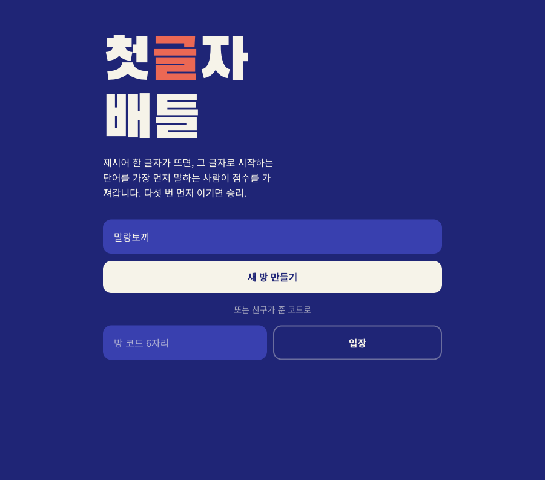
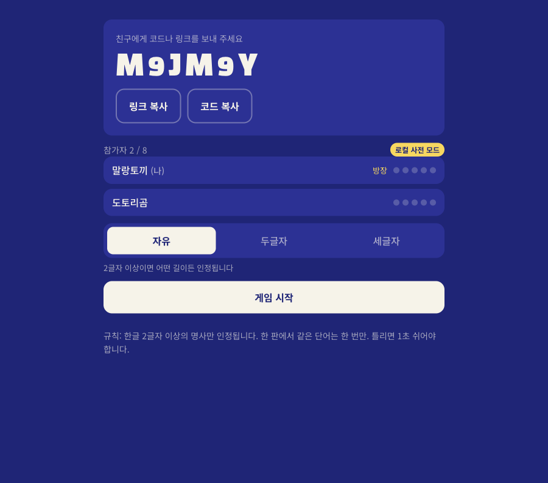
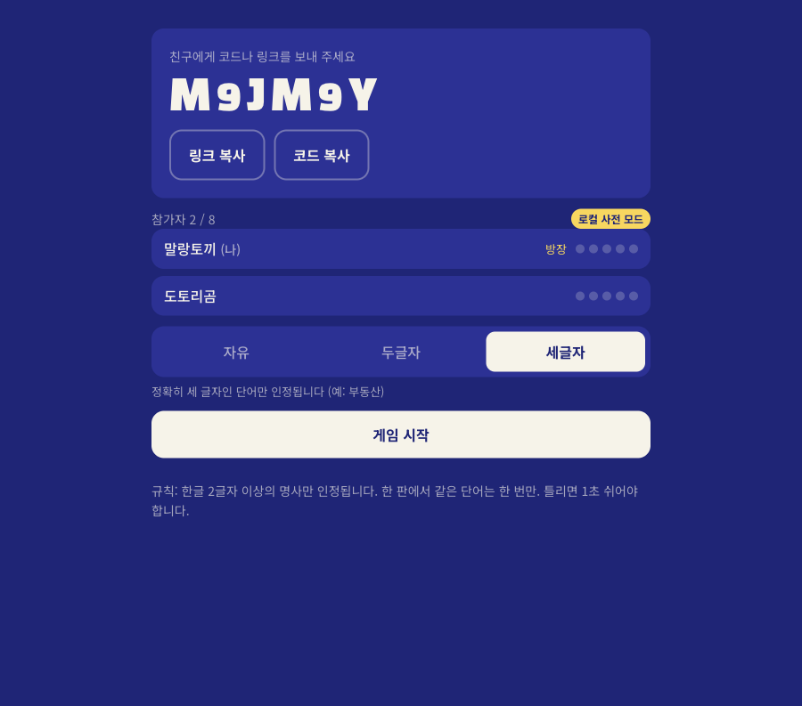
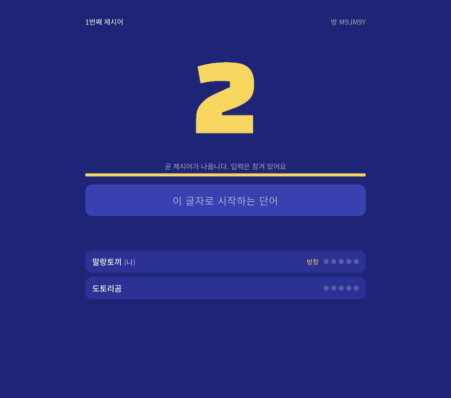
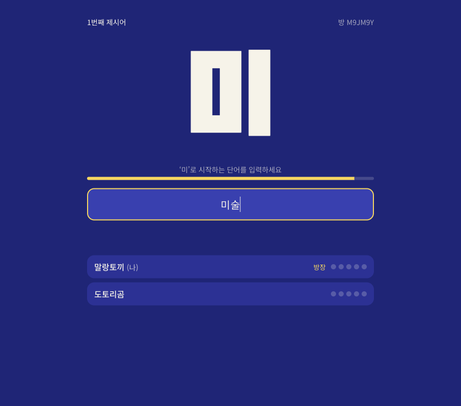
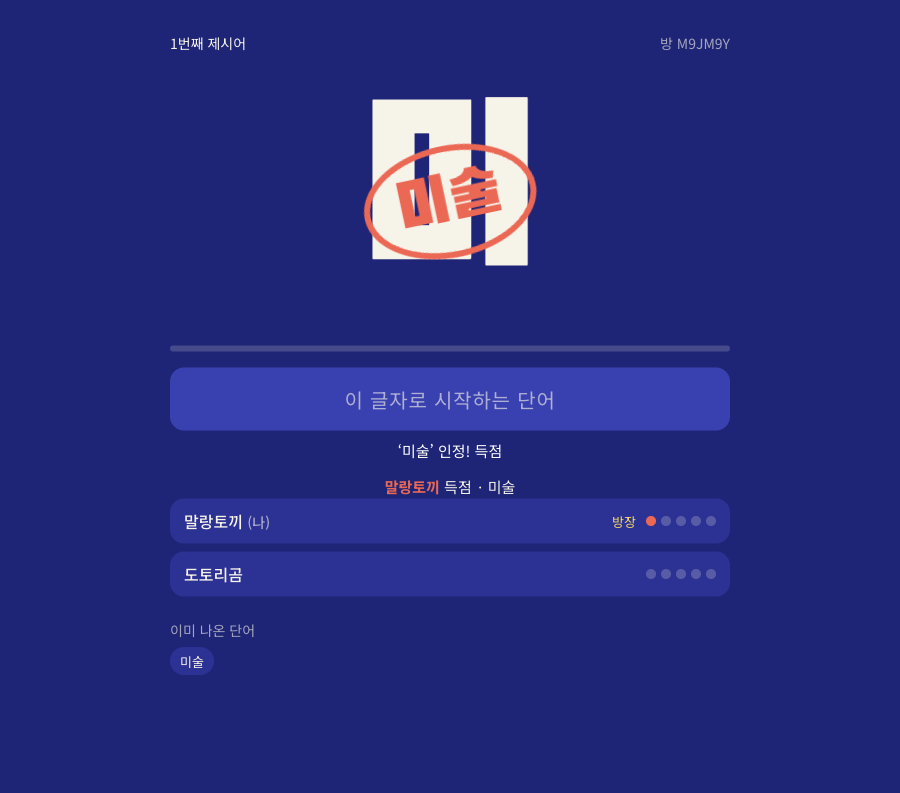
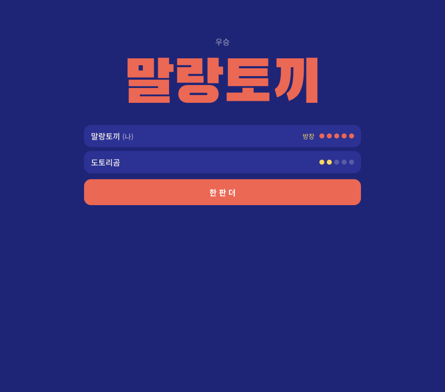

# 🐰 첫글자 배틀 (Word Rush)

> 글자 하나가 뿅! 나타나면, 그 글자로 시작하는 단어를 **제일 먼저** 외치는 사람이 이겨요 ⚡

친구들과 한 방에 모여 실시간으로 겨루는 한국어 단어 순발력 게임이에요.
설치도, 가입도 없이 링크만 열면 바로 시작! 👉 **[quiz.ooo.codes](https://quiz.ooo.codes)**

---

## 🎮 이렇게 놀아요

### 1. 닉네임을 정하고 방 만들기

귀여운 닉네임을 적고 **새 방 만들기**를 눌러요. 친구가 만든 방이 있다면 방 코드 6자리를 넣고 **입장**!

### 2. 로비에서 친구 기다리기 👯

방 코드나 링크를 친구에게 보내 주세요. 2명 이상 모이면 방장이 **게임 시작**을 누를 수 있어요. (최대 8명)

방장은 로비에서 **단어 길이 모드**도 고를 수 있어요 — 자유 / 두글자 / 세글자 ✨

### 3. 두근두근 카운트다운 ⏳

3, 2, 1… 이때는 입력이 잠겨 있어요. 손가락 풀고 준비!

### 4. 제시어 등장! 빨리 입력하기 ⌨️

글자가 나오면 그 글자로 시작하는 **명사**를 입력하고 엔터! 20초 안에 아무도 못 맞히면 다음 글자로 넘어가요.

### 5. 득점 쾅! 🎯

가장 먼저 인정된 단어에 도장이 쾅 찍히고 1점을 얻어요. 한 번 나온 단어는 그 판에서 다시 못 써요.

### 6. 5점 먼저 모으면 우승 🏆

먼저 5점을 모은 사람이 우승! 방장이 **한 판 더**를 누르면 같은 방에서 계속 놀 수 있어요.

---

## 📋 규칙 한눈에 보기

| 항목 | 규칙 |
|---|---|
| 🙆 인정 | 제시어로 시작하는 한글 2글자 이상 명사 |
| 🔁 중복 | 한 판에서 나온 단어는 다시 못 써요 |
| 🙅 오답 | 1초 동안 쉬어야 해요 |
| ⏱️ 라운드 | 카운트다운 3초 → 최대 20초 |
| 🏆 승리 | 5점 먼저 모으기 |
| 📏 길이 모드 | 자유 · 두글자 · 세글자 (방장이 선택) |

같은 순간에 냈다면? 서버에 **먼저 도착한** 단어가 이겨요. 손이 빠른 사람이 최고! 🐇💨

---

지금 바로 친구를 불러 보세요 👉 **[quiz.ooo.codes](https://quiz.ooo.codes)**

개발자용 실행·배포 안내는 [docs/DEVELOPMENT.md](docs/DEVELOPMENT.md)에 있어요.
